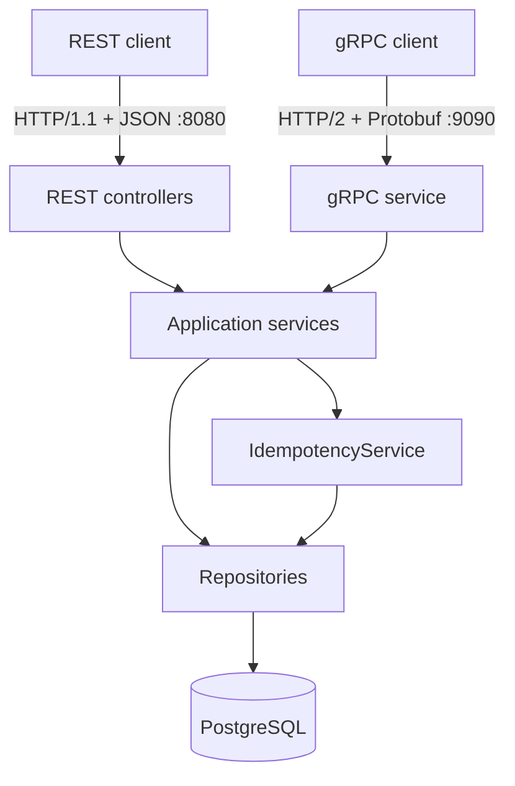
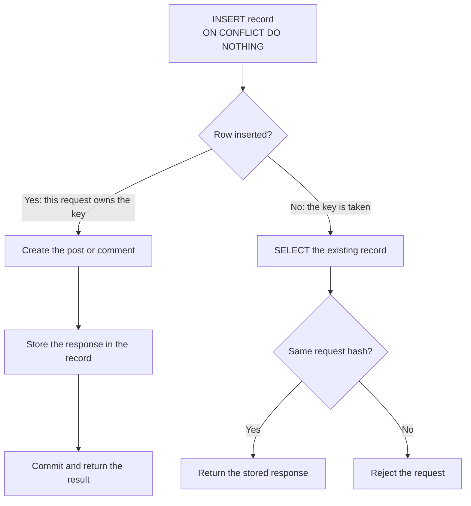
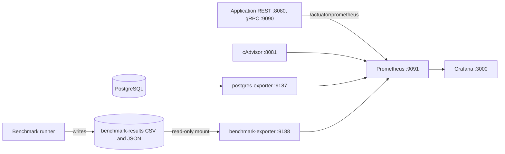

# Blog Platform: gRPC vs REST

SIS #2 for the Highload Backend course. This project implements a blog service over **gRPC with HTTP/2 and
Protocol Buffers**, implements the same service as a **REST/JSON** baseline, and compares the two with a
measured benchmark.

Both protocols run the same business logic against the same PostgreSQL database. Create operations are
idempotent, and the clients use bounded retries with deadlines.

**Measured result:** gRPC was moderately faster on one laptop, with 1-17% higher throughput across 20
comparisons. Serialization alone accounts for only a small part of that gap. See
[Benchmark results](#12-benchmark-results).

## Contents

1. [Project overview](#1-project-overview)
2. [Architecture](#2-architecture)
3. [gRPC, HTTP/2 and Protobuf](#3-grpc-http2-and-protobuf)
4. [REST baseline](#4-rest-baseline)
5. [API operations](#5-api-operations)
6. [Idempotency](#6-idempotency)
7. [Timeouts and retries](#7-timeouts-and-retries)
8. [Running the application](#8-running-the-application)
9. [Running the tests](#9-running-the-tests)
10. [Running the benchmarks](#10-running-the-benchmarks)
11. [Benchmark methodology](#11-benchmark-methodology)
12. [Benchmark results](#12-benchmark-results)
13. [Analysis of gRPC vs REST](#13-analysis-of-grpc-vs-rest)
14. [Limitations and improvements](#14-limitations-and-improvements)
15. [Monitoring with Prometheus and Grafana](#15-monitoring-with-prometheus-and-grafana)

## 1. Project overview

This project continues SIS #1, a system design for a read-heavy blog platform with users, posts and comments.

| SIS #1 target | Value |
|---|---|
| Read throughput | 4,000 RPS |
| Write throughput | 200 RPS |
| Stored posts | 5 million |
| API latency | p99 under 120 ms |

SIS #2 focuses on the protocol layer. It deliberately leaves out parts of the SIS #1 design that do not affect
the comparison, such as Redis and load balancing.

| Technology | Version |
|---|---|
| Java | 21 |
| Spring Boot | 3.5.16 |
| gRPC Java | 1.85.1 |
| Protocol Buffers | 3.25.9 |
| PostgreSQL | 17 |
| Flyway, Hibernate | Managed by Spring Boot |
| JUnit 5, Testcontainers | Managed by Spring Boot |

## 2. Architecture

The system is a modular monolith: one deployable application with its modules expressed as packages.



```
src/main/proto/blog/v1/blog.proto    The gRPC contract
src/main/java/kz/kbtu/blog/
    api/rest/       Controllers, JSON DTOs, exception handler
    api/grpc/       gRPC service, Protobuf mapper, status mapping, server startup
    api/            Shared by both protocols: dev auth, failure classification
    application/    All business logic: PostService, CommentService, IdempotencyService
    domain/         Entities and domain exceptions
    persistence/    Spring Data repositories
    client/         Retry logic and the REST and gRPC clients
    benchmark/      Benchmark runner, journal and reports
src/main/resources/db/migration/     Flyway migrations
scripts/seed-dataset.sql             Large dataset generator
benchmark-results/                   Measurements and analysis
monitoring/                          Prometheus, Grafana and the benchmark results exporter
```

The rule that keeps the comparison fair is that **`api/` only translates**. Controllers and the gRPC service
read a request, call an application service, and shape the response. Validation, ownership checks and
idempotency all live in `application/`, so the two protocols cannot behave differently.

Services throw domain exceptions, and each protocol maps them to its own status:

| Failure | HTTP | gRPC |
|---|---|---|
| Invalid input, missing idempotency key | 400 | `INVALID_ARGUMENT` |
| Missing or unknown user | 401 | `UNAUTHENTICATED` |
| Not the owner | 403 | `PERMISSION_DENIED` |
| Resource not found | 404 | `NOT_FOUND` |
| Idempotency key reused with different data | 422 | `ALREADY_EXISTS` |
| Database unavailable or session lost | 503 | `UNAVAILABLE` |
| Unexpected error (details stay in the log) | 500 | `INTERNAL` |
| Client deadline passed | Client timeout | `DEADLINE_EXCEEDED` |

Pagination uses keyset cursors. A query starts directly at the last row of the previous page through the
indexes `(author_id, created_at DESC, id DESC)` and `(post_id, created_at DESC, id DESC)`. With 100,000 posts
seeded, a page at row 800 read 24 database pages with a cursor and 829 with `OFFSET`.

## 3. gRPC, HTTP/2 and Protobuf

**Protocol Buffers** is a binary format. The `.proto` file defines messages, and fields travel as numbers
rather than names: `post_id = 1` sends the number 1, while JSON repeats `"postId"` in every object.

**HTTP/2** carries many requests at once over one connection by splitting them into frames. This is called
multiplexing. HTTP/1.1 handles one request at a time per connection, so concurrent requests need several
connections.

**gRPC** is the RPC framework that combines them. From [blog.proto](src/main/proto/blog/v1/blog.proto), Maven
generates a server base class and typed client stubs during the build. All operations here are unary: one
request and one response. gRPC also sends the client's deadline to the server, which REST has no standard way
to do. Request metadata is gRPC's version of HTTP headers.

The server is plain grpc-java started by [GrpcServerLifecycle](src/main/java/kz/kbtu/blog/api/grpc/GrpcServerLifecycle.java).
It needs no starter library, so the whole setup is visible in about 100 lines. Server reflection is enabled so
that tools such as `grpcurl` can call the API without a copy of the `.proto` file.

## 4. REST baseline

The REST API exposes the same operations through Spring MVC controllers with JSON bodies. It runs over
HTTP/1.1 with keep-alive, which is a common REST setup. Errors use one format, and its codes match the gRPC
status names:

```json
{"code": "NOT_FOUND", "message": "post 999 not found"}
```

To keep the baseline fair, neither side uses TLS or compression, and both have 200 worker threads and share
one pool of 32 database connections.

## 5. API operations

Reads are public. Writes identify the caller through `X-User-Id` (REST) or `x-user-id` metadata (gRPC).

| Operation | gRPC method | REST endpoint | REST success |
|---|---|---|---|
| Create post | `CreatePost` | `POST /api/v1/posts` | 201 |
| Get post | `GetPost` | `GET /api/v1/posts/{postId}` | 200 |
| List author's posts | `GetAuthorPosts` | `GET /api/v1/users/{userId}/posts?limit=&cursor=` | 200 |
| Update post | `UpdatePost` | `PUT /api/v1/posts/{postId}` | 200 |
| Delete post | `DeletePost` | `DELETE /api/v1/posts/{postId}` | 204 |
| Create comment | `CreateComment` | `POST /api/v1/posts/{postId}/comments` | 201 |
| List comments | `GetComments` | `GET /api/v1/posts/{postId}/comments?limit=&cursor=` | 200 |
| Update comment | `UpdateComment` | `PUT /api/v1/comments/{commentId}` | 200 |
| Delete comment | `DeleteComment` | `DELETE /api/v1/comments/{commentId}` | 204 |

- **Creates** require an idempotency key: the `Idempotency-Key` header in REST, or `idempotency_key` in gRPC.
- **Pagination:** `limit` is 1-100 and defaults to 20, and `0` also means the default. Pass `nextCursor` from
  the previous page as `cursor`. The last page has no cursor in REST and an empty one in gRPC.
- **Validation:** titles are up to 200 characters, post content up to 10,000 and comments up to 2,000. None
  may be blank.
- **Ownership:** only the author can change or delete a post or comment. Deleting a post also deletes its
  comments.

> **Authentication is development-only.** The caller simply states a user id, so anyone can act as anyone. This
> keeps the focus on protocols and must not be used in production. The dev users `alice`, `bob` and `carol`
> have ids 1, 2 and 3.

## 6. Idempotency

A client that gets a timeout cannot know whether its request succeeded. Retrying could create a duplicate, and
not retrying could lose the write. Idempotency keys make retrying safe.

### The flow

The client generates one UUID per logical operation. Everything below happens in **one PostgreSQL transaction**,
in [IdempotencyService](src/main/java/kz/kbtu/blog/application/IdempotencyService.java):



The database enforces `UNIQUE (user_id, operation_type, idempotency_key)`. The unique constraint alone would
not be enough: the replay and mismatch checks above are what give the client a correct answer.

### Design decisions

- **Hash of the business fields:** the request hash is SHA-256 over the fields, not the raw bytes, so REST and
  gRPC produce the same hash.
- **Protocol-neutral stored response:** the record stores `PostView` or `CommentView` as JSON and the status
  `CREATED`, with no HTTP codes or REST field names. A key first used over one protocol replays over the other.
- **`READ COMMITTED` is required:** each statement gets a new snapshot, so the `SELECT` sees a row committed
  while the `INSERT` was waiting. Under `REPEATABLE READ` that row would be invisible.
- **No "in progress" status:** the transaction is all-or-nothing, so there is no half-finished state to clean up.
- **Only successes are stored:** a failed create rolls back its record too, so the key stays usable.
- **Replays return the original result:** this holds even if the post was later edited or deleted, because the
  key answers "what did my request do?", not "what exists now?".

### Edge cases

| Situation | What happens |
|---|---|
| First request succeeds, but the client never gets the response | The retry returns the stored response |
| Two identical requests arrive together | PostgreSQL makes the second `INSERT` wait for the first transaction, then it replays |
| Same key with different data | Rejected with 422 or `ALREADY_EXISTS` |
| Backend crashes midway | The transaction rolls back and leaves nothing, so the retry runs normally |
| The request holding a key dies while another waits on it | The waiting request takes over |

### What clients must do

The key must outlive the request, or retries become new operations:

1. Generate the UUID **once**, when the user starts the action, not on each send.
2. Save it **before** sending. A browser can use `localStorage`, keyed by the draft, so a page refresh reuses it.
3. Reuse the same key for every retry, with an identical payload.
4. Delete it only after a definite answer, success or a permanent error.
5. Use a new key for a new action.

The benchmark client follows these rules. [PendingOperationJournal](src/main/java/kz/kbtu/blog/benchmark/PendingOperationJournal.java)
writes each key to disk before sending and resends anything unfinished on the next start.

Updates and deletes do not use keys. An update is a full replacement, so repeating it gives the same state, and
a repeated delete returns not found.

## 7. Timeouts and retries

Both clients share [RetryExecutor](src/main/java/kz/kbtu/blog/client/RetryExecutor.java), so both protocols
follow the same policy. gRPC's built-in retries were not used because REST could not share them.

| Setting | Default |
|---|---|
| Attempts | 3, including the first |
| Timeout per attempt | 500 ms (gRPC deadline, HTTP request timeout) |
| Overall limit | 1500 ms |
| Backoff | Exponential from 50 ms, capped at 400 ms, with full jitter |

| | Retried | Not retried |
|---|---|---|
| gRPC | `UNAVAILABLE`, `DEADLINE_EXCEEDED` | All others, such as `INVALID_ARGUMENT` and `PERMISSION_DENIED` |
| REST | 503, 504, timeouts, connection errors | All other 4xx and 5xx responses |

- **Remaining deadline:** each attempt gets the smaller of 500 ms and the time left. Retrying stops when the wait
  would pass the overall limit.
- **Jitter:** the wait is random between 0 and the current bound, so clients that failed together do not all
  retry at the same moment.
- **Writes:** only reads and keyed creates go through retries. Every attempt carries the same key.

**`DEADLINE_EXCEEDED` does not mean the operation failed.** The client stopped waiting, but the server may still
finish. In the benchmark, 143 of 200 writes the client saw fail had been committed by the server.

On the server, a gRPC call whose deadline passed while it waited for a thread is skipped. Once work has started it
runs to completion. REST has no equivalent, so a timed-out REST request keeps running. The connection pool also
fails after 2 seconds rather than the default 30, so requests do not hold server threads during a database outage.

## 8. Running the application

**Requirements:** Java 21 and Docker. Maven is not needed, because `mvnw` downloads it.

```powershell
# Windows PowerShell, if Java is not on PATH
$env:JAVA_HOME = "C:\path\to\jdk-21"

docker compose up -d --wait     # start PostgreSQL
.\mvnw.cmd spring-boot:run      # REST on 8080, gRPC on 9090
```

On Linux or macOS, use `./mvnw`. Flyway creates the schema on startup.

| Variable | Default |
|---|---|
| `DB_URL` | `jdbc:postgresql://localhost:5432/blog` |
| `DB_USER`, `DB_PASSWORD` | `blog`, `blog` (development only) |
| `DB_POOL_SIZE` | 32 |
| `DB_CONNECTION_TIMEOUT_MS` | 2000 |
| `GRPC_PORT` | 9090 |
| `GRPC_THREADS` | 200 |

**Try REST (PowerShell):**

```powershell
$headers = @{ 'X-User-Id' = '1'; 'Idempotency-Key' = [guid]::NewGuid().ToString() }
$body = '{"title":"Hello","content":"First post"}'
$url = 'http://localhost:8080/api/v1/posts'

# Run this twice: the same key returns the same postId
Invoke-RestMethod -Method Post -Uri $url -Headers $headers -ContentType 'application/json' -Body $body

Invoke-RestMethod 'http://localhost:8080/api/v1/users/1/posts?limit=10'
```

**Try gRPC with `grpcurl` (PowerShell):**

```powershell
docker run --rm fullstorydev/grpcurl:v1.9.3 -plaintext host.docker.internal:9090 list

docker run --rm fullstorydev/grpcurl:v1.9.3 -plaintext -d '{\"post_id\":1}' `
    host.docker.internal:9090 blog.v1.BlogService/GetPost
```

Windows PowerShell 5.1 needs the `\"` escapes and splits JSON containing spaces. On Linux, `host.docker.internal`
needs `--add-host=host.docker.internal:host-gateway`.

## 9. Running the tests

Docker must be running: integration tests start a real PostgreSQL through Testcontainers.

```powershell
.\mvnw.cmd test
```

| Area | Examples |
|---|---|
| Functional | Create, read, update, delete, pagination, validation, Unicode |
| Idempotency | One resource per key, replay, reused key rejected, scope by user and operation |
| Concurrency | 16 identical requests, mixed REST and gRPC duplicates, session killed mid-request |
| Protocol | Same data and same error codes on both protocols, cursors across protocols |
| Reliability | Timeout then retry, deadlines, retry limits, backoff, permanent errors not retried |
| Benchmark | Percentiles, identical targets per protocol, journal recovery, a small end-to-end run |

Concurrency tests hold a real PostgreSQL table lock to pause requests at a known point, and confirm they are in
flight before continuing. Production code has no test hooks.

If tests report `Could not find a valid Docker environment`, check `docker ps` first. Docker Desktop's Resource
Saver can pause an idle engine.

## 10. Running the benchmarks

**1. Seed the data** (the app must have run once, to create the schema):

```powershell
docker compose exec -T postgres psql -U blog -d blog -f /scripts/seed-dataset.sql
```

This generates 1 million posts and 3 million comments and takes up about 2.3 GB. Sizes are configurable. The
SIS #1 target needs about 12 GB by estimate, so move Docker's storage to a larger drive first:

```powershell
docker compose exec -T postgres psql -U blog -d blog -v posts=5000000 -v comments=15000000 -f /scripts/seed-dataset.sql
```

The script adds rows on every run. To start again, use `docker compose down -v`.

**2. Start the server** from the packaged jar:

```powershell
.\mvnw.cmd -DskipTests package
& "$env:JAVA_HOME\bin\java.exe" -Xmx2g -jar target\blog-platform-0.1.0-SNAPSHOT.jar
```

**3. Run the benchmark** in a second terminal, as a separate process. The quotes are required in PowerShell:

```powershell
& "$env:JAVA_HOME\bin\java.exe" '-Dloader.main=kz.kbtu.blog.benchmark.BenchmarkMain' `
    -jar target\blog-platform-0.1.0-SNAPSHOT.jar `
    --run-id=run-3 --requests=20000 --write-requests=5000 --concurrency=16,64 --warmup=2000 --iterations=4
```

Each run gets its own folder, `benchmark-results/<run-id>`, and the benchmark refuses to overwrite existing results.

| Option | Default | Meaning |
|---|---|---|
| `--run-id` | `run-<UTC time>` | Unique run name, used for the folder and in Grafana |
| `--label` | Empty | A short note shown in Grafana |
| `--requests` | 20000 | Reads per run |
| `--write-requests` | 5000 | Writes per run |
| `--concurrency` | 16,64 | Concurrent clients, comma-separated |
| `--warmup` | 2000 | Unrecorded requests before each run |
| `--iterations` | 4 | Repeats per protocol and operation; use an even number |
| `--prewarm-passes` | 3 | Passes over the sampled rows before measuring |
| `--sample-size` | 5000 | Ids sampled per kind |
| `--page-limit` | 20 | Page size for list operations |
| `--seed` | 42 | Random seed |
| `--max-attempts` | 3 | Retry attempts |
| `--attempt-timeout-ms` | 500 | Timeout per attempt |
| `--overall-timeout-ms` | 1500 | Overall limit |
| `--output` | `benchmark-results/<run-id>` | Output folder |

Connection options are `--rest-url`, `--grpc-host`, `--grpc-port`, `--db-url`, `--db-user` and `--db-password`.

A full run takes about 12 minutes. Keep the laptop on AC power and idle: a standby invalidated one attempt here.

Each run writes `raw-runs.csv` (updated as it goes), `summary.csv`, `summary.md`, `serialization-probe.csv` and
`run-metadata.json`.

## 11. Benchmark methodology

- **Separate processes:** the benchmark does not share a JVM with the server.
- **Closed-loop load:** each client sends a request, waits for the response, then sends the next.
- **Identical work:** random targets depend on the seed, not the protocol, so both protocols get the same requests.
- **Warm-up:** the sampled rows are requested through both protocols first, and 2,000 unrecorded requests precede
  each run. Early results in a trial were about 3× slower, mostly from JVM warm-up.
- **Order:** the protocol that goes first alternates each iteration, because the second one benefits from warmer caches.
- **Reads and writes are separate:** reads run first, because writes add rows.
- **Latency** is the whole logical call, including retries, so failures and retries are visible rather than hidden.
- **Throughput** counts successes only.
- **Summaries** are medians across iterations. Percentiles from different runs cannot be averaged, so
  `raw-runs.csv` keeps each run's own values.
- **Payload size** is the serialized body: JSON bytes for REST and Protobuf bytes for gRPC. It excludes HTTP
  headers, the gRPC message prefix, HTTP/2 frames and TCP. **Total network bytes were not measured.**

The test machine was one 8-core laptop with 15.7 GB of RAM, running client, server and PostgreSQL 17 together, with
`shared_buffers=512MB`. Data was 1 million posts and 3 million comments at seeding, and a little more by each run.

## 12. Benchmark results

These are **actual measurements** from two complete runs, not expectations. Full tables are in
[run-1/summary.md](benchmark-results/run-1/summary.md) and [run-2/summary.md](benchmark-results/run-2/summary.md).

gRPC relative to REST, in percent. Positive throughput and negative latency favour gRPC.

| Clients | Operation | Run 1 throughput | Run 1 p50 | Run 1 p99 | Run 2 throughput | Run 2 p50 | Run 2 p99 |
|---:|---|---:|---:|---:|---:|---:|---:|
| 16 | GetPost | +8.2 | -9.5 | +7.7 | +12.8 | -11.0 | -9.8 |
| 16 | GetAuthorPosts | +15.7 | -12.4 | -13.9 | +16.9 | -14.2 | -15.4 |
| 16 | GetComments | +15.5 | -14.0 | -10.7 | +15.4 | -13.1 | -15.7 |
| 16 | CreatePost | +17.2 | -7.9 | -26.0 | +7.8 | -7.1 | -9.7 |
| 16 | CreateComment | +1.0 | -1.0 | +9.6 | +9.9 | -8.3 | -20.7 |
| 64 | GetPost | +14.1 | -10.8 | -23.8 | +12.1 | -12.0 | -5.3 |
| 64 | GetAuthorPosts | +6.8 | -9.8 | +24.9 | +16.0 | -14.3 | -7.5 |
| 64 | GetComments | +9.9 | -9.6 | -13.1 | +14.0 | -12.6 | +8.4 |
| 64 | CreatePost | +9.0 | -7.7 | -1.7 | +12.0 | -10.5 | +1.3 |
| 64 | CreateComment | +16.0 | -9.5 | -19.2 | +6.5 | -7.1 | -4.7 |

Absolute values from run 2, the run without a stall:

| Clients | Operation | REST req/s | gRPC req/s | REST p50 (ms) | gRPC p50 (ms) | REST p99 (ms) | gRPC p99 (ms) |
|---:|---|---:|---:|---:|---:|---:|---:|
| 16 | GetPost | 3,759 | 4,241 | 4.06 | 3.61 | 7.76 | 7.00 |
| 16 | GetAuthorPosts | 2,166 | 2,531 | 7.11 | 6.10 | 13.10 | 11.08 |
| 16 | GetComments | 2,980 | 3,439 | 5.15 | 4.47 | 9.74 | 8.22 |
| 16 | CreatePost | 1,113 | 1,200 | 13.64 | 12.67 | 24.43 | 22.07 |
| 16 | CreateComment | 1,046 | 1,150 | 14.44 | 13.24 | 28.85 | 22.87 |
| 64 | GetPost | 3,683 | 4,127 | 16.84 | 14.81 | 30.65 | 29.03 |
| 64 | GetAuthorPosts | 2,177 | 2,524 | 28.65 | 24.56 | 50.98 | 47.14 |
| 64 | GetComments | 3,014 | 3,435 | 20.26 | 17.70 | 38.24 | 41.44 |
| 64 | CreatePost | 1,014 | 1,136 | 60.68 | 54.30 | 101.70 | 103.05 |
| 64 | CreateComment | 1,141 | 1,216 | 54.64 | 50.79 | 88.45 | 84.29 |

Average **application payload** in run 2 (not network traffic):

| Operation | REST response (bytes) | gRPC response (bytes) | Change |
|---|---:|---:|---:|
| GetPost | 1,156 | 1,055 | -8.7% |
| GetAuthorPosts (20 posts) | 23,257 | 21,240 | -8.7% |
| GetComments | 6,738 | 4,745 | -29.6% |
| CreatePost | 1,159 | 1,057 | -8.8% |
| CreateComment | 347 | 242 | -30.3% |

**Errors:** run 2 had no failures or retries. Run 1 had 200 gRPC failures and 618 retries, all in CreateComment
with 64 clients, during a stall that hit both protocols.

## 13. Analysis of gRPC vs REST

The full analysis is in [benchmark-results/analysis.md](benchmark-results/analysis.md).

- **gRPC was moderately faster.** It had higher throughput and lower median latency in all 20 comparisons. The
  throughput gap exceeded the run-to-run noise in 8 of them, always in gRPC's favour.
- **Tail latency was inconclusive.** gRPC had worse p99 in 5 of 20 comparisons.
- **This compares transport, serialization and framework together.** HTTP/2 vs HTTP/1.1, Protobuf vs JSON, and
  Netty vs Tomcat with Spring MVC all differ at once. Differences must not be attributed to Protobuf alone.
- **Serialization is a small share.** Protobuf was about 3-5× faster to serialize and 4-9× faster to parse in
  isolation, but that accounts for only about 0.4-13% of the median latency gap in the two operations checked.
  The estimate is rough. The rest is unattributed, and this benchmark cannot divide it between transport and
  framework.
- **Payload savings depend on content.** Protobuf saves on field names and numbers, while text costs the same in
  both. Savings were about 9% for posts with long text and about 30% for short comments.
- **Idempotency proved its value.** In run 1's stall, 143 of 200 writes the client saw fail had actually committed.
  Resending them with the same keys added exactly 57 comments, with no duplicates.
- **SIS #1 targets:** writes exceeded 200 RPS on this laptop. Only GetPost came near 4,000 read RPS. Median p99
  stayed under 120 ms in clean conditions, though not in every iteration or during the stall. This was not a
  capacity test: everything shared one laptop, with no mixed workload, at about a fifth of the target post count.

For this workload, gRPC's speed gain is real but modest. Its typed contract and built-in deadlines may matter as
much as its speed. REST remains easier to inspect and use from a browser.

## 14. Limitations and improvements

**Limitations of the benchmark**

- Client, server and database shared one laptop, so absolute numbers would differ on separate machines.
- Closed-loop load can understate tail latency.
- Two runs show direction, not precise percentages.
- Reads were mostly cached, after warming a sample of 5,000 ids per kind.
- Results come from 1 million posts, not the 5 million target, and no mixed workload was tested.
- Run 1's stall has no confirmed cause. Autovacuum and a checkpoint were active around then.
- Compare protocols within a run. Run 1's writes changed the sampled posts, so GetComments differs across runs.

**Limitations of the implementation**

- Authentication is a development stand-in.
- Idempotency records are kept forever. A real system needs a retention job.
- Each create leaves a dead row in `idempotency_records`, because the record is inserted and then updated. That
  adds autovacuum work.
- Duplicates waiting on a key each hold a database connection until the first request finishes.
- Redis, load balancing and multiple instances from SIS #1 are not implemented.

**Possible improvements**

- Run JSON over HTTP/2, to separate transport from serialization directly.
- Put client, server and database on separate machines.
- Use a fixed-rate load generator, and test a mixed workload at 5 million posts.
- Capture real network bytes with a packet capture.
- Log autovacuum during runs, to investigate the stall.

## 15. Monitoring with Prometheus and Grafana

Grafana shows the measured benchmark results next to live application and database metrics. The dashboard is
**Blog Platform — REST vs gRPC Performance Benchmark**.



| Component | Port on host | Purpose |
|---|---|---|
| Application | 8080 REST, 9090 gRPC | Runs on the host. Exposes `/actuator/prometheus` |
| Prometheus | 9091 | Stores time series. The host's 9090 is taken by gRPC |
| Grafana | 3000 | Dashboards |
| postgres-exporter | 9187 | PostgreSQL statistics |
| benchmark-exporter | 9188 | Publishes the result files as metrics |
| cAdvisor | 8081 | Docker container resources |

The monitoring services use a Compose profile, so a plain `docker compose up` still starts PostgreSQL alone. They
use no extra database, and PostgreSQL is not restarted or changed.

### Start everything

```powershell
$env:JAVA_HOME = "C:\path\to\jdk-21"

# 1. PostgreSQL and the monitoring stack
docker compose --profile monitoring up -d

# 2. The application, in its own terminal
.\mvnw.cmd -DskipTests package
& "$env:JAVA_HOME\bin\java.exe" -Xmx2g -jar target\blog-platform-0.1.0-SNAPSHOT.jar
```

| Open | Address | Login |
|---|---|---|
| Grafana | <http://localhost:3000> | None needed to view. Admin: `admin` / `admin` |
| Prometheus | <http://localhost:9091> | None |
| Prometheus targets | <http://localhost:9091/targets> | None |

Change the admin password outside development by setting `GRAFANA_ADMIN_PASSWORD` before starting. Anonymous viewing
is on for convenience, so do not expose this setup to a network.

To stop the monitoring services and keep all data:

```powershell
docker compose --profile monitoring stop
```

> **Warning:** `docker compose down -v` deletes the volumes, **including the benchmark database**.

### How benchmark results reach Grafana

1. The benchmark writes its files to `benchmark-results/<run-id>/`. These stay the source of truth.
2. `benchmark-exporter` reads every run folder on each scrape, through a read-only mount, and publishes the values.
3. Prometheus scrapes them, and Grafana queries Prometheus.

A new run appears within about 15 seconds of finishing, with no restart. An unfinished run is skipped. If Prometheus
data were deleted, the values would return on the next scrape, because Prometheus only holds a copy. Results are
stored per operation, not per request, so each run adds a few hundred series.

### Run a new benchmark and compare it

Use the benchmark command from [section 10](#10-running-the-benchmarks). Then, in Grafana:

| Variable | Use |
|---|---|
| **Run** | Select several runs to compare them, such as `run-1` and `run-2` |
| **Clients** | 16, 64 or both |
| **Operation** | GetPost, GetAuthorPosts, GetComments, CreatePost, CreateComment |
| **Protocol** | REST, gRPC or both |
| **Focus operation** | The single operation used by the client-count and iteration charts |

`smoke-1` is a small validation run, labelled as such. It is not a performance result, so do not compare it with full runs.

### Dashboard panels

| Section | Panels | How to read them |
|---|---|---|
| A. Executive overview | Run details table, throughput, p99, improvement, payload reduction | Stats are means of the selected medians, so they mix fast and slow operations. Use the charts for detail |
| B. Throughput | By operation, 16 vs 64 clients, every iteration, live RPS, gain per run | Compare the iteration spread with the gap between protocols before trusting a difference |
| C. Latency | p50, p95 and p99 by operation, reductions, live heatmaps, live percentiles | Positive reduction favours gRPC. Negative p99 bars are real results |
| D. Payload and serialization | Response size, serialize and parse time, Protobuf speedup | Sizes exclude headers and framing. Serialization numbers come from an isolated loop |
| E. Reliability | Run 1 incident, stall by iteration, error rate, failures, retries, live idempotency outcomes | Observed facts and suspected causes are shown separately |
| Live traffic | REST by endpoint, gRPC by method, status codes | Empty when nothing is running |
| F. Infrastructure | Heap, non-heap, CPU, GC, threads, uptime, connection pool, PostgreSQL, containers | Use during a run to spot bottlenecks such as a waiting connection pool |

### Metrics collected

| Source | Metrics |
|---|---|
| REST | `http_server_requests_seconds`: count, duration and histogram, by URI, method and status |
| gRPC | `grpc_server_requests_seconds`: the same, by method and status, from [GrpcMetricsInterceptor](src/main/java/kz/kbtu/blog/api/grpc/GrpcMetricsInterceptor.java) |
| Idempotency | `blog_idempotency_outcomes_total`: `created`, `replayed`, `conflict` |
| JVM | Heap, non-heap, GC, CPU, threads, uptime, connection pool |
| PostgreSQL | Connections by state, transactions, cache hit ratio, rows, locks, deadlocks, database size |
| Docker | CPU, memory, network, containers running |
| Benchmark | `benchmark_summary_*`, `benchmark_iteration_*`, `benchmark_comparison_*`, `benchmark_serialization_*`, `benchmark_run_*`, `benchmark_incident_*` |

REST and gRPC use the same histogram settings, 1 ms to 10 s, and both timers run on the server from receiving a
call to finishing the response.

### Limitations of the metrics

- **Live charts cannot show runs 1 and 2.** Those runs finished before the application was instrumented. Their
  results come from the CSV files, so they appear in the benchmark charts but not the live ones.
- **Unavailable, and not estimated:** latency distributions for runs 1 and 2, successful retries, per-query PostgreSQL
  statistics (these need `pg_stat_statements`, which requires restarting PostgreSQL) and total network bytes.
- **Live and benchmark numbers differ.** Benchmark latency is measured on the client and includes retries. Live latency
  is estimated on the server from histogram buckets.
- **Timestamps in benchmark panels are scrape times,** not when the run happened. The run's real time is in the table.
- **Run 1's incident figures** were counted from the database and journal, and saved in
  [run-1/incident.json](benchmark-results/run-1/incident.json). The benchmark did not produce them automatically.
- **Instrumentation and scraping add a small cost,** which runs 1 and 2 did not have. New runs may therefore not be
  directly comparable with them. Compare REST and gRPC within one run.
- **A stuck gRPC call is recorded when its handler finishes,** not when the client gives up.

The dashboard is generated by [generate_dashboard.py](monitoring/grafana/generate_dashboard.py). Change that file and
run it, because Grafana does not save edits to a provisioned dashboard.

To test the exporter:

```powershell
python -m unittest discover -s monitoring/benchmark-exporter
```
